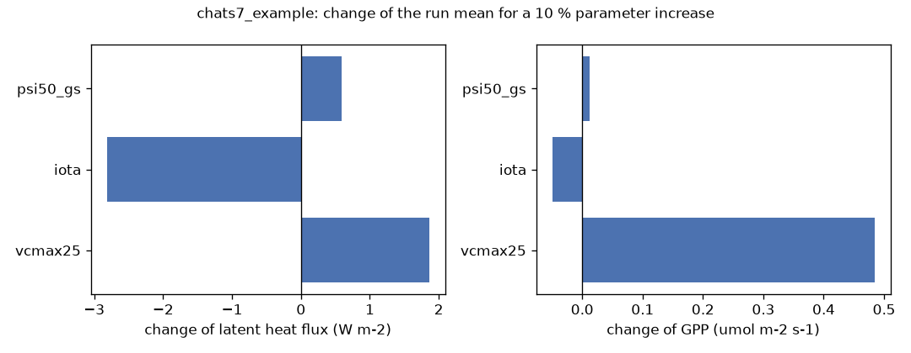

# Examples

Plain Python scripts in [`examples/`](repo:examples), run from the repository's top folder.
Each one starts with what it does and how to run it.

## A tower run: `run_tower.py`

Runs one day at CHATS (or any experiment folder), prints the mean fluxes and saves a figure of
the fluxes through the day and of the canopy air temperature profile at noon and at night.

```bash
python examples/run_tower.py                                  # CHATS7, 1 May 2007
python examples/run_tower.py --length "7 days"
python examples/run_tower.py --set model.processes.stomatal_conductance.scheme=medlyn
python examples/run_tower.py --folder my_tower                # your own tower
```

```{literalinclude} ../examples/run_tower.py
:language: python
:start-at: "def main"
:end-before: "def plot"
```

## Parameter sensitivity by gradients: `sensitivity_tower.py`

How much do the day's mean latent heat flux and GPP at CHATS change with the maximum
carboxylation rate (`vcmax25`), the stomatal water-use efficiency (`iota`) and the leaf water
potential at half stomatal closure (`psi50_gs`)? One backward pass through the whole day gives
all six derivatives; the script checks them against finite differences (two extra runs per
parameter).

```bash
python examples/sensitivity_tower.py              # the CHATS7 day, about a minute on a laptop
python examples/sensitivity_tower.py --steps 12   # a short check
```

Output for 1 May 2007 (change of the day's mean for a 10 % increase of each parameter):

```text
47 steps; means: latent_heat_flux 134.42 W m-2, gpp 11.60 umol m-2 s-1

  parameter  output               gradient  finite diff.
  vcmax25    latent_heat_flux       1.8606        1.8288
  vcmax25    gpp                    0.4841        0.4833
  iota       latent_heat_flux      -2.8151       -2.7908
  iota       gpp                   -0.0497       -0.0491
  psi50_gs   latent_heat_flux       0.5936        0.5675
  psi50_gs   gpp                    0.0121        0.0115
```



`psi50_gs` is negative (−1.6 MPa for walnut): a 10 % increase makes it more negative, so the
stomata close only at lower leaf water potential and transpiration rises.

The gradients agree with the finite differences to within a few percent. They are not exact
where the leaves are water stressed: by default the derivative of the water stress follows a
stabilized rule, which keeps gradients over long runs from growing without bound
(`model.yaml` `numerics.water_stress_derivative`; see
[How the model works](how_the_model_works.md#6-gradients)).

The core of the script: run the model as a function of the parameters, and let JAX
differentiate it.

```{literalinclude} ../examples/sensitivity_tower.py
:language: python
:start-at: "    def run_means"
:end-at: "grad = np.asarray"
```

The same pattern gives the derivative of any output with respect to any parameter, the
forcing or the initial state (`clm_ml.model.Model`).

## A global run: `run_global.py` and `plot_global_diag.py`

`run_global.py` sets up a case on the 1° CLM grid (CRUJRA forcing, CLM6 parameters, CTSM 5.4
soil water; the input files are on NCAR's Glade storage). Edit the settings at its top (case
folder, dates, region, machine, GPUs, account) and run it; it writes the case folder and, on
Derecho, a batch job:

```bash
python examples/run_global.py
qsub CASE_DIR/submit.pbs          # on Derecho; elsewhere: clm-ml run CASE_DIR
```

The whole globe (about 72 600 patches on 14 300 gridcells) needs a GPU: a 10-day chunk takes
about 15 minutes on one A100. A small region (e.g. `REGION = "{lat: [35, 40], lon: [-100,
-95]}"`) runs on a CPU.

`plot_global_diag.py` maps the time mean of every variable of a grid run's gridcell output:

```bash
python examples/plot_global_diag.py CASE_DIR/output --variables gpp latent_heat_flux
```
